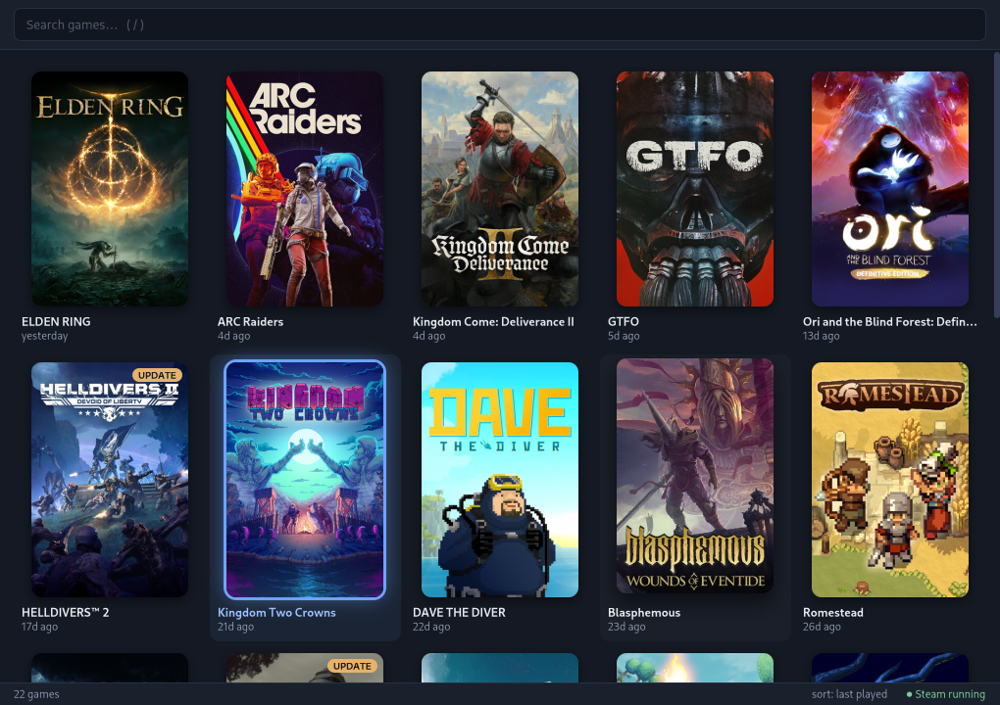
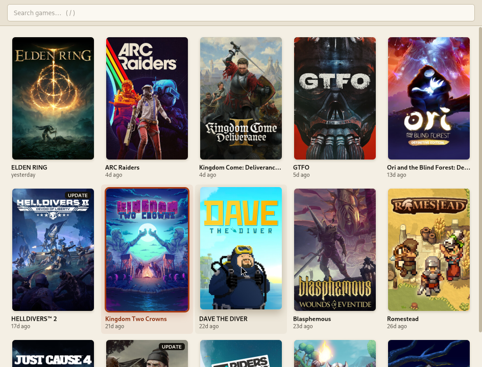
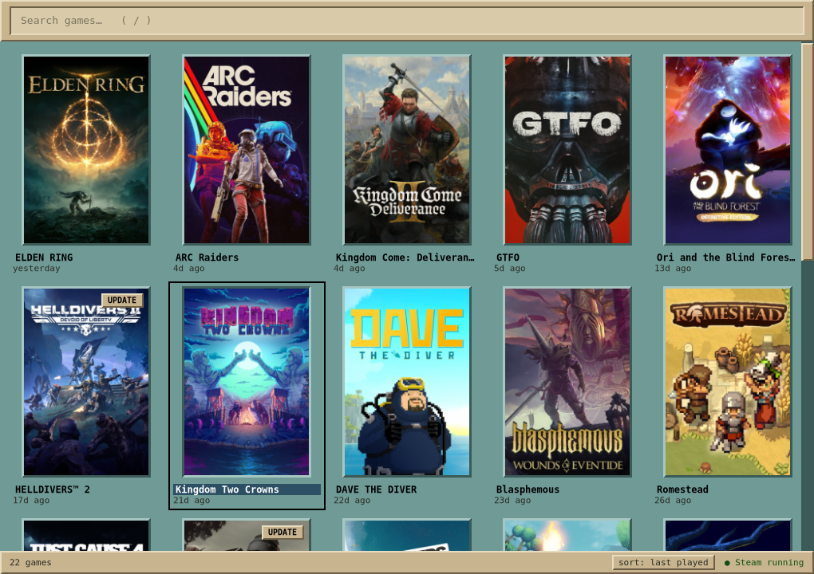

# steamlite

A lightweight native launcher for your installed Steam games, so you never
have to open Steam's heavy CEF UI.

steamlite does **not** replace Steam. The Steam client keeps running hidden in
the background (`steam -silent`), and steamlite launches games through it with
`steam -applaunch <appid>`. It only ever *reads* Steam's files.



| paper | cde |
|---|---|
|  |  |

- Rust + gtk4-rs, no libadwaita, no web views, no network access at runtime.
- About 1 MB binary, ~40 MB PSS / ~58 MB RSS idle, first frame in ~120–140 ms
  (see [Measurements](#measurements)).
- Works on X11 (i3) and Wayland.

## Install

### From source, any distro (recommended)

```bash
git clone https://github.com/plaintextlab/steam-lite && cd steam-lite && ./install.sh
```

`install.sh` detects your distro and installs everything the build needs
(Rust/cargo, pkg-config, a C compiler, the GTK 4 development files), using
`sudo` or `doas` for the package step only. It then builds steamlite and
installs it to `~/.local`. It supports Void, Arch and derivatives,
Debian/Ubuntu and derivatives, Fedora/RHEL-likes, openSUSE and Alpine.

- If your distro's Rust is older than 1.83, it installs a current one with
  rustup instead.
- If your GTK is older than 4.16, it stops and points you to the Flatpak.

Options: `--system` (install to `/usr/local`), `--deps-only`, `--uninstall`,
`--dry-run` (print the commands without running them).

### Packages

Prebuilt packages are on the
[releases page](https://github.com/plaintextlab/steam-lite/releases).

| Package | Works on |
|---|---|
| `steamlite_<ver>_amd64.deb` | Debian 13+, Ubuntu 25.04+ (needs GTK ≥ 4.16) |
| `steamlite-<ver>-1.x86_64.rpm` | Fedora 41+, openSUSE Tumbleweed |
| `steamlite-<ver>.flatpak` | Any distro with Flatpak (pulls the GNOME 51 runtime) |

```bash
sudo apt install ./steamlite_0.1.0_amd64.deb
```

```bash
sudo dnf install ./steamlite-0.1.0-1.x86_64.rpm
```

```bash
flatpak install --user ./steamlite-0.1.0.flatpak
```

The Flatpak reads your Steam files read-only (`--filesystem=host:ro`), keeps
its config in the usual `~/.config/steamlite`, and starts the host's `steam`
through `flatpak-spawn --host`. That last permission
(`--talk-name=org.freedesktop.Flatpak`) means the sandbox can run commands on
the host, which a launcher needs. The window class is still `steamlite`, so the i3
rule below works unchanged.

Packages are built with the scripts in `packaging/` (`build-deb.sh`,
`build-rpm.sh`, `build-flatpak.sh`, `build-appimage.sh`), into `dist/`.

### Arch Linux

From a checkout of this repository:

```bash
makepkg -si
```

The PKGBUILD builds the checkout it sits in, runs the tests and installs
`/usr/bin/steamlite` plus `steamlite.desktop`.

### Manually

Install Rust ≥ 1.83, pkg-config, a C compiler and the GTK ≥ 4.16
development files (the package names per distro are in `install.sh`). Then
run `cargo build --release` and copy `target/release/steamlite` onto your
PATH.

## i3 / sway

Start Steam hidden with your session, float the launcher, and bind a key:

```
# ~/.config/i3/config
exec --no-startup-id steam -silent
for_window [class="(?i)^steamlite$"] floating enable, resize set 1020 720, move position center
bindsym $mod+g exec --no-startup-id steamlite
```

On sway the window matches by app id:

```
for_window [app_id="steamlite"] floating enable, resize set 1020 720, move position center
```

You don't have to start Steam yourself: if it isn't running when you launch a
game, steamlite starts it hidden in the same command (see below).

## Keys

| Key | Action |
|---|---|
| *typing* | The search box is focused on open; results filter (fuzzy) as you type |
| `Enter` | Launch the selected game (from the search box or the grid) |
| `↓` / `Tab` | Search box → grid |
| arrows / `h` `j` `k` `l` | Move in the grid (`k` on the top row goes back to search) |
| `PgUp` / `PgDn`, `g` / `G`, `Home` / `End` | Page, first, last |
| `/` | Focus search |
| `Esc` | Clear the search; if it's already empty, quit |
| `s` | Cycle sort: last played → name → size on disk |
| `r` / `F5` | Rescan libraries |
| `Menu` / `Shift+F10` / right-click | Context menu: Launch, Open install folder, Show appid |
| `q` / `Ctrl+Q` | Quit |

Mouse: double-click a tile to launch it, right-click for the menu, and click
the sort label in the status line to change the sort.

## Configuration

`~/.config/steamlite/config.toml` is created with commented defaults on the
first run. Edits are picked up live: theme, tile size and library paths apply
without a restart.

| Key | Default | Meaning |
|---|---|---|
| `theme` | `"midnight"` | `midnight`, `paper` or `cde` |
| `tile_width` | `160` | Cover width in px; height follows the 2:3 cover ratio |
| `sort` | `"last_played"` | Initial sort: `last_played`, `name` or `size` |
| `close_on_launch` | `true` | Quit after starting a game |
| `steam_command` | `"auto"` | `steam`, or `flatpak run com.valvesoftware.Steam` for Flatpak installs. Inside a distrobox use `"distrobox-host-exec steam"` |
| `steam_flags` | `[]` | Extra flags used only when steamlite has to start Steam, e.g. `["-cef-disable-gpu-compositing"]` |
| `extra_library_paths` | `[]` | Library folders missing from Steam's `libraryfolders.vdf` |
| `terminal` | `""` | For the planned steamcmd integration; empty means `$TERMINAL` |
| `renderer` | `"cairo"` | GSK renderer. `cairo` is lightest; `gl`, `ngl`, `vulkan` or `""` let GTK use the GPU. The `GSK_RENDERER` env var wins |

### How launching works

1. steamlite checks whether Steam is running, via `~/.steam/steam.pid` (and
   the Flatpak equivalent), falling back to looking for a `steam` process in
   `/proc`.
2. If Steam is running, it runs `steam -applaunch <appid>`.
3. If it isn't, it runs `steam -silent <steam_flags…> -applaunch <appid>`.
   That one command starts the client hidden *and* queues the game, which
   avoids two `steam` processes racing each other.
4. The child is spawned detached (own process group, no inherited stdio), so
   steamlite can quit right away.

Set `STEAMLITE_DRY_RUN=1` to print the command instead of running it.

## Theming

All styling lives in GTK CSS embedded in the binary (`data/css/`):

- `base.css` holds structure only.
- Each theme file sets CSS custom properties on `:root`: palette, spacing,
  radii, shadows and the transition timing (≤ 120 ms).

So a theme is mostly a palette swap. To make your own, put overrides in
`~/.config/steamlite/style.css`; it is loaded on top of the built-in theme and
**live-reloaded** when you save:

```css
:root {
  --accent: #ff4fa3;
  --focus-shadow: 0 0 0 3px #ff4fa3, 0 0 22px rgba(255, 79, 163, 0.6);
  --radius: 14px;
}
.tile .title { color: #ffd34f; }
```

Variables you can set: `--bg --bg-alt --surface --input-bg --fg --fg-dim
--border --border-width --accent --accent-fg --accent-glow --title-selected
--ok --warn --badge-bg --badge-fg --scroll --tile-hover --tile-selected
--cover-shadow --cover-shadow-hover --focus-shadow --popover-shadow --lift
--ph-fg --ph-0 … --ph-5 --radius --radius-small --pad --pad-wide --tile-pad
--font --font-size --title-size --sub-size --t`.

Useful selectors: `window.steamlite`, `.header`, `entry.search`,
`flowboxchild.tile` (`:selected` is the keyboard cursor), `.tile .cover`,
`.tile .title`, `.tile .subtitle`, `.placeholder`, `.badge`, `.statusbar`,
`.statusbar .steam.running` / `.stopped`, `popover.menu button.menuitem`.

The system GTK theme is kept out on purpose:

- GTK's base theme is pinned to its built-in Adwaita (`GTK_THEME`, unless you
  set it yourself).
- steamlite's CSS is added just above USER priority. APPLICATION priority
  alone would still lose to `~/.config/gtk-4.0/gtk.css`, which theme tools
  often fill with global rules such as `* { border-radius: 0; }`.

## Data sources (read-only)

- Steam roots: `~/.local/share/Steam`, `~/.steam/steam`, `~/.steam/root` (the
  symlinks are de-duplicated), and the Flatpak root
  `~/.var/app/com.valvesoftware.Steam/…`.
- Libraries: `steamapps/libraryfolders.vdf` (current and legacy formats) plus
  `extra_library_paths`.
- Games: every `steamapps/appmanifest_*.acf`. An app is shown when
  `StateFlags` has the "fully installed" bit (an `UPDATE` badge marks pending
  updates).
- Non-games such as Proton, Steam Linux Runtime and Steamworks redistributables
  are filtered by appid and name pattern. The list lives in `src/filter.rs`.
- Last played: the newer of the manifest's `LastPlayed` and
  `userdata/*/config/localconfig.vdf`. It's optional; missing files are fine.
- Covers: `appcache/librarycache`, in both the old flat layout
  (`<appid>_library_600x900.jpg`) and the per-appid layout, including the
  hashed subdirectories newer clients use (`<appid>/<sha1>/library_600x900.jpg`
  or `library_capsule.jpg`). Covers are decoded off the main thread at tile
  size, only for tiles near the viewport. Games without art get a coloured
  tile with their initials.

## Measurements

Measured with `STEAMLITE_TIMING=1`: wall-clock time from `exec` to the first
painted frame, and memory from `/proc/<pid>/smaps_rollup` after the covers had
loaded. Library: 22 games, all with covers, on a 1020×720 window.

| Environment | First frame (median, 8 runs) | RSS | PSS | Idle CPU |
|---|---|---|---|---|
| Void + i3 + picom (X11), from a Debian distrobox, NVIDIA | 118–141 ms over two sessions (107–158) | 58 MB | 39 MB | 0 % |
| Xvfb, no window manager (reference) | 114 ms | 40 MB | 27 MB | 0 % |

RSS counts shared libraries (GTK, cairo, fonts) in full, and on X11 it also
counts the shared-memory paint buffer (~6 MB). PSS is the fairer per-process
number. Both runs were "warm" (files in the page cache). A truly cold start
after dropping caches wasn't measured.

What it took to get there:

- **No GL on the cairo path.** On X11, GDK otherwise loads the GPU driver just
  to pick a visual, even with the cairo renderer: 155 MB RSS instead of 68 MB.
  steamlite sets `GDK_DISABLE=gl,vulkan` when the renderer is cairo.
- **Lazy tooltips.** `gtk_widget_set_tooltip_text()` cost about 8 ms per tile
  (190 ms for the grid). Tooltips are now built on demand.
- **No icon in the search box.** One symbolic icon pulled in the icon theme,
  librsvg and libxml2 (about 8 MB).
- **One malloc arena.** The cover decode threads otherwise leave per-thread
  arenas resident (about 4 MB).
- **No caret blink.** With the cairo renderer each blink repaints the whole
  window (about 8 % CPU while searching); blinking is turned off for
  steamlite only.

## Development

```bash
cargo test
```

```bash
cargo run --release --example scan
```

`examples/scan.rs` prints what steamlite would show (appid, name, size, cover
path) and how long the scan took (about 2 ms here).

Code layout:

```
src/vdf.rs        KeyValues (.vdf/.acf) parser
src/library.rs    Steam roots, library folders, manifests, last played
src/filter.rs     the non-game list (appids + name patterns)
src/art.rs        cover lookup (all cache layouts), initials
src/fuzzy.rs      subsequence matcher with word-start/prefix bonuses
src/sort.rs       sort orders, size/time formatting
src/launcher.rs   Steam detection, launch command, detached spawn
src/config.rs     config.toml with commented defaults
src/theme.rs      embedded CSS, user override, file watching   (GTK)
src/art_loader.rs off-thread decoding at tile size + cache       (GTK)
src/ui.rs         window, grid, keyboard handling, menu         (GTK)
tests/            parser, filter and scan tests against fixtures
```

## Not included

- **steamcmd "Update / Verify"** (phase 2): not implemented yet. The `terminal`
  config key is reserved for it, and login will stay interactive in steamcmd
  (steamlite will never handle your password).
- No DRM bypassing and no Steam API emulation, by design.
